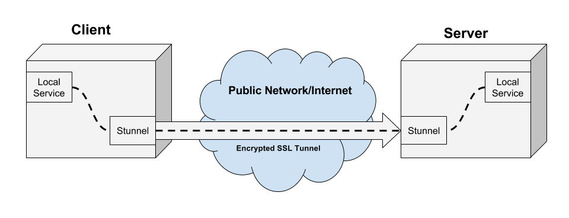
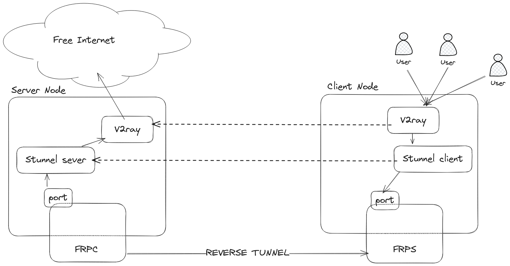

## [V2Ray](https://www.v2ray.com/) Configuración + STUNNEL + FRP [CONFIGURACIÓN FÁCIL](#easy-setup)
(Antes de comenzar, revisa __otras ramas__ para otras configuraciones)


https://charlesreid1.github.io/stunnel.html


### ¿Qué hace Stunnel?

Stunnel es una herramienta para crear túneles SSL entre un cliente y un servidor.

GITHUB DE STUNNEL: https://github.com/mtrojnar/stunnel

### ¿Qué es frp?

frp es un proxy inverso rápido que te permite exponer un servidor local ubicado detrás de un NAT o firewall a Internet. Actualmente soporta los protocolos TCP y UDP, así como HTTP y HTTPS, permitiendo que las solicitudes se reenvíen a servicios internos mediante nombre de dominio.

GITHUB DE FRP: https://github.com/fatedier/frp

### Descripción general de la arquitectura

### Configuración
Como puedes ver en la imagen anterior, configuraremos stunnel como nuestro túnel seguro y haremos pasar el tráfico de v2ray a través de él.
(Los __Servicios Locales__ en la imagen anterior, en este caso, son el __nodo v2ray__)

### Pasos

1 - Ejecuta `install.sh` para instalar los requisitos en cada VPS. (No podemos ejecutarlos en pods ya que estamos usando `systemctl`)

2 - Configurar stunnel en `server-node`:
```Bash
cd v2ray-setup
vim server.conf # Modify V2RAY-PORT to a real free port like 9999
cp server.conf /etc/stunnel/
cd /etc/stunnel/
openssl genrsa -out stunnel.key 2048
# Please avoid to use some random stuff like test.
openssl req -new -key stunnel.key -out stunnel.csr
openssl x509 -req -days 365 -in stunnel.csr -signkey stunnel.key -out stunnel.crt
cat stunnel.crt stunnel.key > stunnel.pem # You need to use it in client as well
sudo systemctl restart stunnel4.service
systemctl status stunnel4.service # You should see everything is fine
```

3 - Configurar frpc en `server-node`:

```Bash
wget https://github.com/fatedier/frp/releases/download/v0.58.1/frp_0.58.1_linux_amd64.tar.gz
tar -xvf frp_0.58.1_linux_amd64.tar.gz
cd frp_0.58.1_linux_amd64
```

Ajusta `frpc.toml` de la siguiente manera:

```Bash
serverAddr = "{client-node IP/domain}"
serverPort = 7000 # Default

[[proxies]]
name = "test-tcp"
type = "tcp"
localIP = "127.0.0.1"
localPort = 443 # This is stunnel server listening port
remotePort = 4444 # Expected port in client node.
```

Luego ejecuta:
```Bash
./frpc -c frpc.toml
```

O define un servicio systemd y habilítalo/inícialo.

4 - Configurar stunnel en `client-node`:
```Bash
cd v2ray-setup
vim client.conf # Use your server ip in the config
cp client.conf /etc/stunnel/
scp {STUNNEL_SERVER}:/etc/stunnel/stunnel.pem /etc/stunnel/stunnel.pem
sudo systemctl restart stunnel4.service
systemctl status stunnel4.service # You should see everything is fine
```

5 - Configurar frps en `client-node`:

```Bash
wget https://github.com/fatedier/frp/releases/download/v0.58.1/frp_0.58.1_linux_amd64.tar.gz
tar -xvf frp_0.58.1_linux_amd64.tar.gz
cd frp_0.58.1_linux_amd64
```

Luego ejecuta:
```Bash
./frps -c frps.toml
```

O nuevamente define un servicio systemd y habilítalo/inícialo.


Nota: Definir un servicio systemd te ayuda a instalar el servicio en tu máquina de manera más estable.

6 - Configurar x-ui en el servidor (en la VPS de stunnel) y crear una cuenta allí con un puerto que escuche en `V2RAY-PORT`, como 9999.

Configuración de ejemplo (predeterminada)
```json
{
  "api": {
    "services": [
      "HandlerService",
      "LoggerService",
      "StatsService"
    ],
    "tag": "api"
  },
  "inbounds": [
    {
      "listen": "127.0.0.1",
      "port": 62789,
      "protocol": "dokodemo-door",
      "settings": {
        "address": "127.0.0.1"
      },
      "tag": "api"
    }
  ],
  "outbounds": [
    {
      "protocol": "freedom",
      "settings": {}
    },
    {
      "protocol": "blackhole",
      "settings": {},
      "tag": "blocked"
    }
  ],
  "policy": {
    "system": {
      "statsInboundDownlink": true,
      "statsInboundUplink": true
    }
  },
  "routing": {
    "rules": [
      {
        "inboundTag": [
          "api"
        ],
        "outboundTag": "api",
        "type": "field"
      },
      {
        "ip": [
          "geoip:private"
        ],
        "outboundTag": "blocked",
        "type": "field"
      },
      {
        "outboundTag": "blocked",
        "protocol": [
          "bittorrent"
        ],
        "type": "field"
      }
    ]
  },
  "stats": {}
}
```
4 - Configurar x-ui en el cliente

Ten en cuenta que en la configuración del cliente debes usar `localhost:4443` en lugar de la IP del servidor, puerto, como se muestra a continuación:
```json
{
  "api": {
    "services": [
      "HandlerService",
      "LoggerService",
      "StatsService"
    ],
    "tag": "api"
  },
  "inbounds": [
    {
      "listen": "127.0.0.1",
      "port": 62789,
      "protocol": "dokodemo-door",
      "settings": {
        "address": "127.0.0.1"
      },
      "tag": "api"
    }
  ],
  "outbounds": [
      {
        "tag": "proxy",
        "protocol": "vmess",
        "settings": {
          "vnext": [
             {
            "address": "localhost",
            "port": 4443,
            "users": [
              {
                "alterId": 0,
                "encryption": "",
                "flow": "",
                "id": "{VMESS-ID}",
                "level": 8,
                "security": "auto"
              }
            ]
          }
        ]
      },
      "streamSettings": {
        "network": "tcp",
        "security": "none",
        "tcpSettings": {
          "header": {
            "type": "none"
          }
        }
      },
      "tag": "proxy"
    },

    {
      "protocol": "blackhole",
      "settings": { },
      "tag": "blocked"
    },
    {
      "tag": "InternalDNS",
      "protocol": "dns"
    }
  ],
  "policy": {
    "system": {
      "statsInboundDownlink": true,
      "statsInboundUplink": true
    }
  },
  "routing": {
    "rules": [
      {
        "type": "field",
        "outboundTag": "freedom",
        "domain": [
          "regexp:.*\\.ir$",
          "domain:digikala.com",
          "snapp.express",
          "aparat.com",
          "full:google.com",
          "overleaf.com",
        ]
      },
      {
        "inboundTag": [
          "api"
        ],
        "outboundTag": "api",
        "type": "field"
      },
      {
        "outboundTag": "blocked",
        "protocol": [
          "bittorrent"
        ],
        "type": "field"
      }
    ]
  },
  "stats": { }
}
```

¡No dudes en administrar tus cuentas directamente desde el servidor cliente!


## Depuración

1 - Usa `journalctl -fu stunnel4.service` para verificar los registros relacionados (u otros registros como frpc/frps)

2 - Para verificar tu servidor stunnel puedes usar el siguiente comando:

```bash
openssl s_client -connect {STUNNEL_SERVER/CLIENT}:4443 -debug -msg -servername cloudflare.com -tls1_2 
```

3 - Verificar el firewall

4 - `iftop, tcpdump, telnet, ss, nc` son herramientas de red generales y útiles


<a name="easy-setup"></a>
## Configuración fácil con [FAB](https://www.fabfile.org/)

Configurar el entorno
```bash
python3.8 -m venv venv
source venv/bin/activate
fab -l # To see list of jobs
```

1 - Configurar nodos con requisitos:

```bash
export I_USER={}
export E_USER={}
export I_H={} # Domain or IP
export E_H={} # Domain or IP
fab setup-nodes -H $I_USER@I_H,$E_USER@$E_H
```

2 - Configurar nodo externo (frp, stunnel):
```bash
fab setup-external-node --internal-node-ip $I_H -H $E_USER@$E_H
```

3 - Configurar nodo interno (frp, stunnel):
```bash
fab setup-internal-node --external-address $E_USER@$E_H -H $I_USER@$I_H
```

4 - Ve al puerto 54321 de x-ui externo e inicia sesión con `admin, admin` y crea una cuenta vmess con configuración tcp y selecciona el `UID` para usarlo en el siguiente paso.

5 - Ve al puerto 54321 de la IP/dominio interno, inicia sesión con admin,admin y actualiza la configuración a:
```json
{
    "api": {
      "services": [
        "HandlerService",
        "LoggerService",
        "StatsService"
      ],
      "tag": "api"
    },
    "inbounds": [
      {
        "listen": "127.0.0.1",
        "port": 62789,
        "protocol": "dokodemo-door",
        "settings": {
          "address": "127.0.0.1"
        },
        "tag": "api"
      }
    ],
    "outbounds": [
        {
          "tag": "proxy",
          "protocol": "vmess",
          "settings": {
            "vnext": [
               {
              "address": "localhost",
              "port": 4443,
              "users": [
                {
                  "alterId": 0,
                  "encryption": "",
                  "flow": "",
                  "id": {{UID FROM EXTERNAL HOST}},
                  "level": 8,
                  "security": "auto"
                }
              ]
            }
          ]
        },
        "streamSettings": {
          "network": "tcp",
          "security": "none",
          "tcpSettings": {
            "header": {
              "type": "none"
            }
          }
        },
        "tag": "proxy"
      },
  
      {
        "protocol": "blackhole",
        "settings": { },
        "tag": "blocked"
      },
      {
        "tag": "InternalDNS",
        "protocol": "dns"
      }
    ],
    "policy": {
      "system": {
        "statsInboundDownlink": true,
        "statsInboundUplink": true
      }
    },
    "routing": {
      "rules": [
        {
          "type": "field",
          "outboundTag": "freedom",
          "domain": [
            "regexp:.*\\.ir$",
            "domain:digikala.com",
            "snapp.express",
            "aparat.com",
            "full:google.com",
            "overleaf.com"
          ]
        },
        {
          "inboundTag": [
            "api"
          ],
          "outboundTag": "api",
          "type": "field"
        },
        {
          "outboundTag": "blocked",
          "protocol": [
            "bittorrent"
          ],
          "type": "field"
        }
      ]
    },
    "stats": { }
  }
```

¡Disfrútalo!
