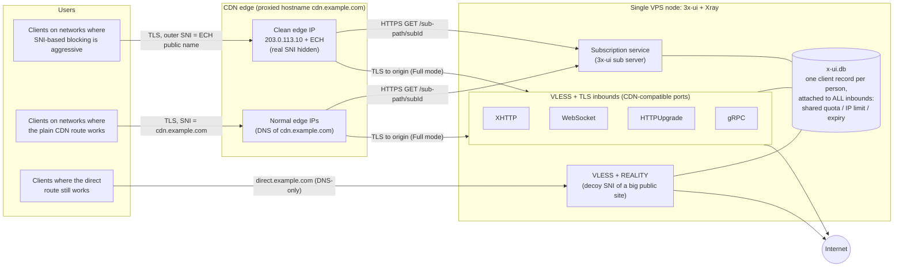
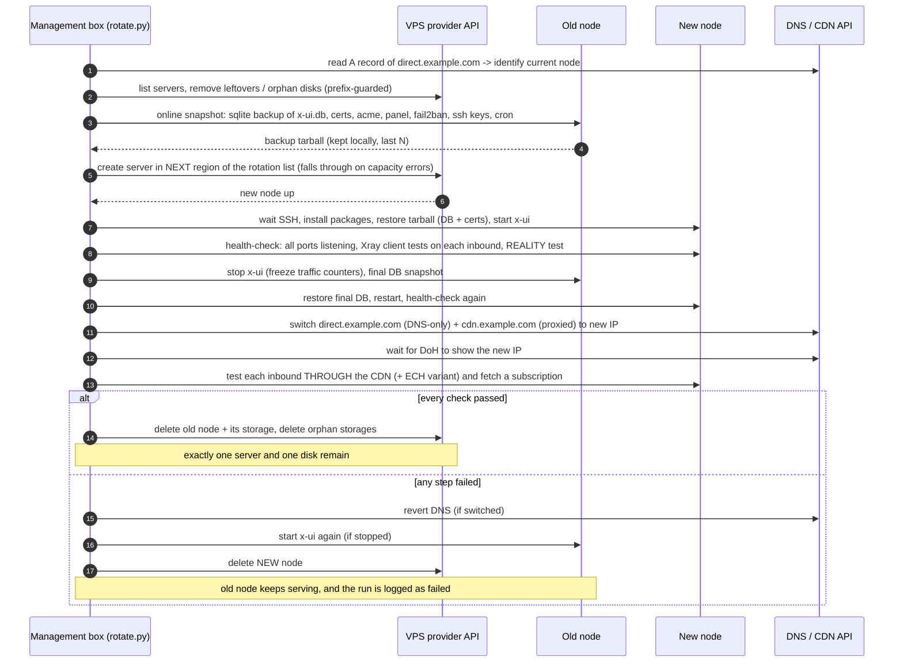

# Current architecture: 3x-ui + Xray, CDN-fronted, rotating node

This replaces the older STUNNEL + FRP setup described in the main [readme](../readme.md), which is kept for reference.
Everything here uses placeholders: `cdn.example.com` (proxied through the CDN), `direct.example.com` (DNS-only),
`203.0.113.10` (a "clean" CDN edge IP). Paths, ports, UUIDs and keys are your own; never commit them.

## Goals

* **One node at a time.** A single small VPS runs [3x-ui](https://github.com/MHSanaei/3x-ui) + Xray. There is no fleet to keep in sync.
* **The node's IP doesn't matter much.** Most users reach it through a CDN, so a blocked or burned server IP is fixed by rotating to a new one.
* **One identity per person.** Each person has **one client record** that's attached to every inbound. Quota, IP limit and expiry are shared, so a person can't double their quota by using two transports.
* **Links never change.** Clients import a **subscription URL** served through the CDN. When an inbound or address changes, they press "update" and don't need a new link.
* **Hands-off.** A script rotates the node every 2 nights through the provider APIs and rolls back by itself if anything fails.

## Topology

### Inbounds

| Inbound | Transport / security | Reached via | Notes |
|---|---|---|---|
| XHTTP | VLESS + XHTTP + TLS | CDN | Most CDN-friendly. Works with HTTP/2 and HTTP/1.1. |
| WebSocket | VLESS + WS + TLS | CDN | Widest client support. |
| HTTPUpgrade | VLESS + HTTPUpgrade + TLS | CDN | Lighter than WS. Supported by recent clients. |
| gRPC | VLESS + gRPC + TLS | CDN | Turn on gRPC in the CDN's network settings. Works well with ECH. |
| REALITY | VLESS + TCP + REALITY | Direct | No certificate, no CDN. Borrows the TLS handshake of a decoy site. Fast where the server IP isn't blocked. |

* The TLS inbounds use only the ports the CDN proxies for HTTPS (for example 443, 2053, 2083, 2087, 2096, 8443), one inbound per port.
* The origin certificate is issued for `direct.example.com` (ACME standalone, which needs a DNS-only record). The CDN connects to the origin in *Full* mode and sends `Host: cdn.example.com`.
* The CDN's own edge certificate covers `cdn.example.com` for clients.

### Link variants generated per inbound

The subscription uses 3x-ui **Hosts** (per-inbound address/SNI/host/fingerprint/ECH overrides) with the remark template `{{HOST}}`. One inbound can therefore produce several ready-to-use entries:

1. **ECH + clean edge IP.** `address = 203.0.113.10`, `sni = cdn.example.com`, `echConfigList = <public-name>+<DoH>` (for example `cloudflare-ech.com+https://1.1.1.1/dns-query`). The censor sees only the ECH public name, and the clean IP avoids edge ranges that are throttled. This is for networks where SNI-based blocking is aggressive.
2. **Plain CDN.** `address = cdn.example.com`, normal SNI and fingerprint. This is for networks where the plain CDN route works.
3. **Direct REALITY.** `address = direct.example.com`. This is for when the server IP is reachable.

Entries are numbered so the preferred variant sorts first in the clients.

Lessons learned:

* TLS ClientHello **fragmentation stopped helping** on the strict networks. ECH with a clean edge IP is what works there.
* UDP/QUIC toward the CDN is often blocked. Stick to TCP transports.
* Don't test the direct `:443` path from a machine whose egress re-routes traffic by SNI. Test a non-443 inbound, or test from the node itself.

## Subscription service

* The 3x-ui sub server listens on a CDN HTTPS port and is served as `https://cdn.example.com:<port>/<sub-path>/<subId>`.
* Each person's client record has a `subId`. The subscription lists every inbound × variant for that one client.
* Because the URL points at the CDN hostname, it keeps working across node rotations and IP changes.

## Rotation every 2 nights

The [`rotation/`](../rotation) scripts (Python, stdlib + paramiko) run from a separate management box on a timer (for example cron `0 3 */2 * *`).
They need only an UpCloud API sub-account, a Cloudflare token scoped to *Zone DNS: Edit*, and an SSH key.
Other providers can be added by swapping the small `uc()` client.

Notes:

* The **final sync** happens after the new node passed its first checks. Users only lose a few minutes of traffic accounting and a short reconnect.
* The certificate and ACME account travel with the backup. Renewals keep working because `direct.example.com` follows the node.
* The REALITY private key, short IDs and client UUIDs live in the DB, so they are identical on the new node. No client changes are needed.
* The script refuses to touch servers whose hostname doesn't start with `NODE_PREFIX`.

## Hardening checklist

* Panel and subscription paths are random. Expose the panel only on a non-CDN port, or over SSH tunnel.
* Enable fail2ban with the 3x-ui IP-limit jail. Pre-create the 3x-ui log files on fresh nodes, or the jail fails to start.
* Turn on BBR (`/etc/sysctl.d`). Turn off password SSH login.
* Keep API tokens in files outside the repo (`chmod 600`). `rotation/config.env` is git-ignored.
