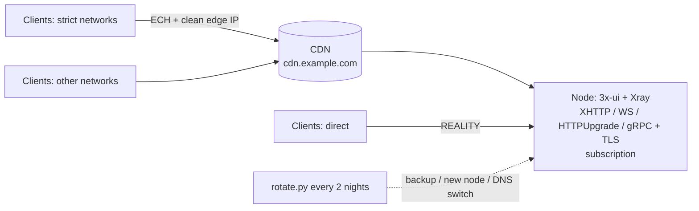

# v2ray-setup

My notes and scripts for running a censorship-resistant VPN. The setup has changed a few times as blocking got stricter.
**The newest approach is described here on `main`.** Each older approach is preserved on its own branch with its full guide and config files.

## Versions

| Version | Approach | Status | Branch | Date |
|---|---|---|---|---|
| **v2** | 3x-ui + Xray: VLESS over XHTTP / WS / HTTPUpgrade / gRPC + TLS behind a CDN, ECH + clean edge IPs, REALITY direct, CDN-served subscription, automatic node rotation every 2 nights | **current** | [`main`](https://github.com/amir-h-rassafi/v2ray-setup/tree/main) (snapshot: [`v2-3xui-cdn-rotation`](https://github.com/amir-h-rassafi/v2ray-setup/tree/v2-3xui-cdn-rotation)) | 2026-10 |
| v1 | V2Ray (x-ui) + STUNNEL + FRP between two VPSes, Fabric "easy setup", backup/restore, health-check timer | legacy | [`v1-stunnel-frp`](https://github.com/amir-h-rassafi/v2ray-setup/tree/v1-stunnel-frp) | 2024-07 → 2024-11 |
| v0.2 | V2Ray (x-ui) + STUNNEL (first clean version, before FRP) | legacy | [`v2ray-stunnel`](https://github.com/amir-h-rassafi/v2ray-setup/tree/v2ray-stunnel) | 2024-07 |
| v0.1 | x-ui bridge → TLS VMess → nginx (SSL) upstream, optional CDN, self-signed TLS | legacy | [`v2ray-nginx-ws`](https://github.com/amir-h-rassafi/v2ray-setup/tree/v2ray-nginx-ws) | 2023-04 → 2023-06 |

> Looking for the old STUNNEL + FRP guide? It's on [`v1-stunnel-frp`](https://github.com/amir-h-rassafi/v2ray-setup/tree/v1-stunnel-frp).
> The v1 files are still at the root of `main` for now: `install.sh`, `fabfile.py`, `requirements.txt`, `health.sh`, `health_check.*`, `frp*.toml`, `frp.service`, `server.conf`, `client.conf`, `config.yml`, `arch.png` and `img.png`. They belong to v1 and are documented only there. The v2 code is in [`rotation/`](rotation).

## Current approach (v2): 3x-ui + Xray behind a CDN, with automatic node rotation

Full write-up: **[docs/ARCHITECTURE.md](docs/ARCHITECTURE.md)**. Scripts: **[rotation/](rotation)**.

* **One node at a time** runs 3x-ui + Xray. Each person has **one client record**, shared across all inbounds (shared quota, IP limit and expiry).
* **CDN-fronted VLESS inbounds** (XHTTP, WebSocket, HTTPUpgrade, gRPC over TLS) sit behind a proxied hostname (`cdn.example.com`).
* **ECH + clean-edge-IP variants** are for networks where SNI-based blocking is aggressive. Plain CDN entries are for networks where the normal CDN route works.
* A **direct VLESS + REALITY** inbound uses a decoy SNI, for when the server IP is reachable.
* A **subscription is served through the CDN**, so clients press "update" instead of receiving new links.
* **Automated rotation every 2 nights** through provider APIs:
  1. back up the DB;
  2. create a node in the next region;
  3. restore the DB and certificates;
  4. health-check;
  5. do a final DB sync;
  6. switch DNS;
  7. delete the old node.

  Any failure rolls back.

### Quick start

1. Install [3x-ui](https://github.com/MHSanaei/3x-ui) on a VPS. Issue a certificate for a DNS-only hostname (`direct.example.com`). Create a proxied hostname (`cdn.example.com`) pointing to the same IP.
2. Create the inbounds and the subscription settings described in [docs/ARCHITECTURE.md](docs/ARCHITECTURE.md). Attach each client to all inbounds.
3. On a separate management machine, set up [rotation/](rotation) (`config.env`) and schedule `rotate.py` every 2 nights.
